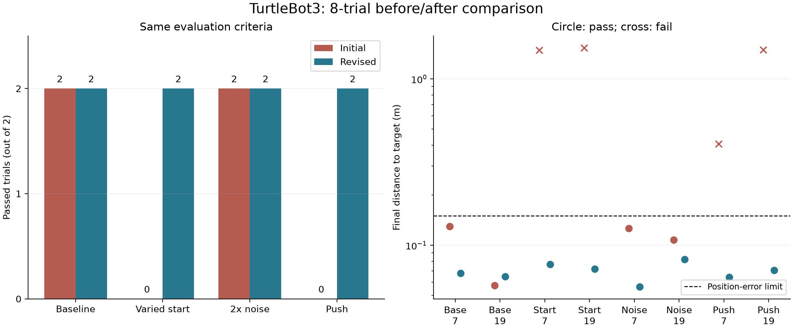
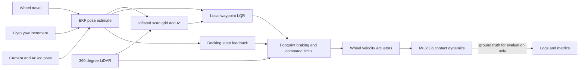
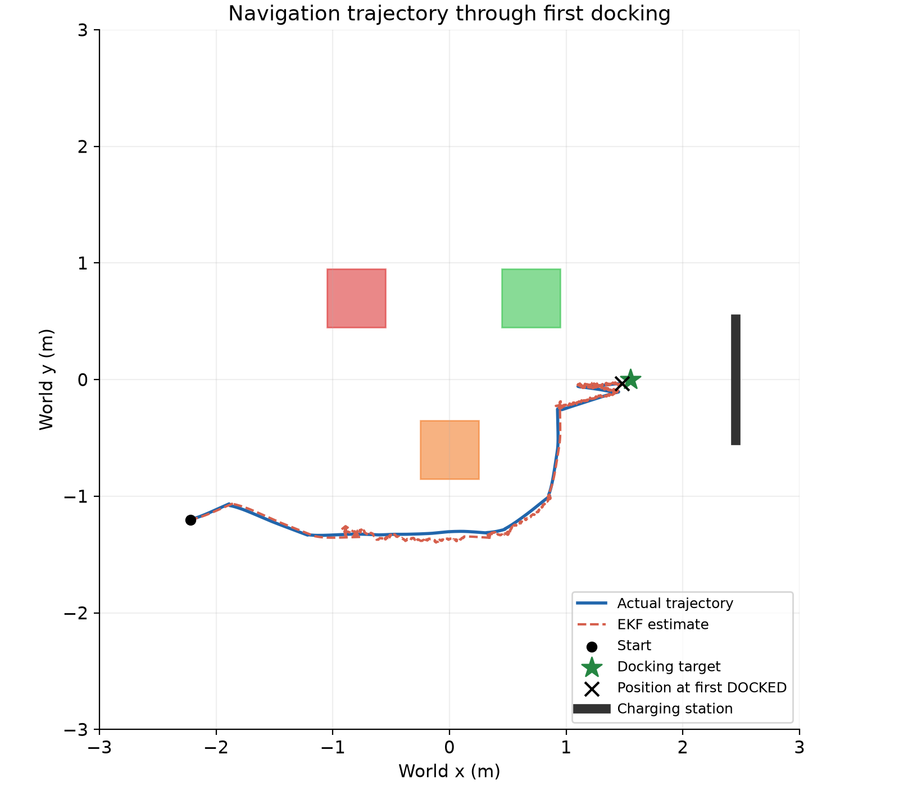

# Vision-guided TurtleBot3 navigation and docking

**Project 17 · 41014 Sensors and Control for Mechatronic Systems · UTS · Spring 2026**

**Team:** Daniel Higuerey-Morales, Lucas Nader and Sidhanth Varma.

A simulated TurtleBot3 Waffle Pi navigates a room containing obstacles and docks
at an ArUco-marked station. Wheel encoders and a simulated gyro predict pose;
camera measurements correct an extended Kalman filter (EKF). A LiDAR planner
and feedback controllers use the **estimated state**, while ground truth is
reserved for simulation and evaluation. This is a **simulation-only Track A**
project; physical hardware is outside scope.

The revised pipeline passed **8/8 defined macOS trials**, compared with **4/8**
for the initial pipeline. Actual final position errors were **5.6–8.2 cm**, with
zero detected robot contacts with obstacles, walls or the dock. These are small,
development-used test samples, not a general reliability claim.



## Demo and verification status

**Five-minute demo video:** not yet recorded; the team will add its URL here.

| Item | Status |
|---|---|
| MuJoCo wheel/contact simulation | Implemented |
| Interactive macOS navigation and docking | Demonstrated |
| Eight-trial macOS comparison | Completed; logs and tested source snapshots retained |
| Windows launch instructions and launcher | Provided; runtime verification pending |
| Hardware implementation | Outside scope |
| Team contribution statements | Awaiting team confirmation |
| Estimate uncertainty in demo | Required by the supplied guide; covariance visualisation still to be captured |

## Generative AI declaration

**Tool:** OpenAI Codex (AI coding assistant). **Purpose:** assistance with Python
and MuJoCo implementation/adaptation, troubleshooting, estimator/controller
changes, experiment automation, quantitative analysis, figures and drafting this
documentation. The documented tests were executed in the project workspace.
The team is responsible for reviewing the material, confirming individual
contribution statements and explaining the submitted pipeline. Team review is pending.

## Run the latest simulation

Start in the repository folder. Follow [installation and troubleshooting](docs/SETUP.md)
first if the project environment has not been created.

**macOS:**

```bash
./.venv/bin/python .venv/bin/mjpython turtlebot.py
```

**Windows PowerShell:**

```powershell
.\.venv\Scripts\python.exe turtlebot.py
```

Alternatively, open [Run Simulation.command](Run%20Simulation.command) on macOS
or [Run Simulation.bat](Run%20Simulation.bat) on Windows. Both select the dynamic
TurtleBot3 build. Close any older simulation before launching; running Python
processes do not automatically load edited code. `main.py` remains the simplified
baseline and shared pipeline module.

Let the robot run through navigation, marker acquisition and docking. Final-suite
trials took approximately 63–90 **simulated** seconds. Rendering can make elapsed
wall-clock time different. Close the viewer normally to save `run_log_turtlebot.csv`.
The next interactive run overwrites that file, so preserve logs you need.

The yellow lines visualise the 72 LiDAR rays. `DOCKED` means the estimated-state
and camera confirmation conditions have been met; actual error is checked
separately in the experiment runner. The overlay's **evaluation position error**
is EKF error, not distance to the docking target.

## Pipeline



The camera mount, 72-ray planar scanner, gyro, motor tuning and smooth tyre
collision proxies are project adaptations of the supplied ROBOTIS model.
The original assets and license are retained under [vendor/robotis_tb3](vendor/robotis_tb3/SOURCE.md).
No ROS server, robot network connection or separate hardware setup is required.

## Results

| Condition · seeds 7 and 19 | Initial passes | Revised passes |
|---|---:|---:|
| Baseline | 2/2 | 2/2 |
| Varied known starting pose | 0/2 | 2/2 |
| Doubled measurement noise | 2/2 | 2/2 |
| Brief lateral force | 0/2 | 2/2 |

Each trial has a 140 simulated-second limit. A pass requires controller docking,
actual target error ≤0.15 m, actual heading error ≤15°, and zero observed hazard
contacts. Ground truth is used to evaluate those criteria, not to guide the robot.
The revised controller's internal stop tolerance is a separate estimated-state
condition.

The comparison includes sensing and controller changes together; it does not
isolate individual improvements. The high-noise filter covariance is adjusted to
match the added noise. Windows, unseen environments, sensor bias/dropout and
unknown initial localisation error remain unverified.

See the [experiment report](docs/RESULTS.md),
[raw final summary](output/robustness_final/summary.csv),
[original failures](output/robustness_initial/findings.md), and
[before/after report](output/robustness_comparison/comparison.md).



## Documentation

| Assessment area | Documentation and implementation |
|---|---|
| Modelling · 20% | [State-space model, controllability and observability](docs/MODEL.md) |
| Sensing · 20% | [Calibration, coordinate frames and noise](docs/SENSING.md) |
| Estimation · 20% | [EKF equations, covariance and measured performance](docs/ESTIMATION.md) |
| Control · 20% | [Planning, LQR, docking and recovery](docs/CONTROL.md) |
| Integration and robustness · 20% | [Experiments, results and limitations](docs/RESULTS.md) |
| Reproduction | [Commands, data schema and evidence directories](docs/REPRODUCIBILITY.md) |
| Video and individual viva | [Five-minute outline and preparation](docs/DEMO_VIVA.md) |
| Team and submission | [Members, contributions and remaining items](docs/TEAM_SUBMISSION.md) |
| Publishing | [Review, push and optional GitHub Pages guidance](docs/PUBLISHING.md) |
| Attribution | [References and licensing](docs/REFERENCES.md) |

## Repository map

| Path | Purpose |
|---|---|
| `turtlebot.py` | Dynamic plant adapter, measured wheel rotations, gyro inputs and current navigation policy |
| `main.py` | Shared rendering, camera processing, EKF, LQR, logging and simplified baseline |
| `navigation.py` | Scan-grid A*, waypoint commitment, braking and docking recovery |
| `scene.xml` | Room, station and simplified baseline model |
| `scene_turtlebot.xml` | Generated dynamic scene; rebuilt when TurtleBot3 starts |
| `scripts/build_turtlebot_scene.py` | Combines the supplied robot and project scene/sensors |
| `scripts/run_robustness.py` | Isolated seeded trials and contact monitoring |
| `scripts/check_navigation.py` | Fast geometry and recovery checks |
| `scripts/validate_simulation.py` | Known-pose camera checks and a regression trial |
| `scripts/plot_results.py` | Trajectory, estimation plots and metrics |
| `scripts/compare_robustness.py` | Matching-suite comparison and figure |
| `output/robustness_initial/` | Original fixed suite, including failures |
| `output/robustness_final/` | Final fixed suite, logs, configuration and source snapshots |

The longer [presentation notes](README_PRESENTATION.md) and
[completion checklist](TRACK_A_CHECKLIST.md) are retained for team use. The
documentation describes the code and saved evidence; it does not claim the video,
Windows verification or publication has already been completed.
