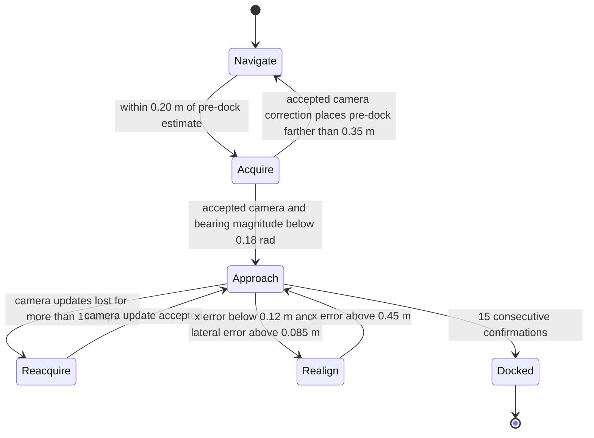

# Planning, tracking and docking

[Project home](../README.md) · [Model](MODEL.md) · [Results](RESULTS.md)

## State use and command chain

`navigation.Navigator` receives a copy of the EKF state, the current range scan,
camera acceptance and predicted landmark bearing. It does not import MuJoCo or
read base pose, obstacle coordinates or evaluation variables. `lqr_to_target`
uses `x_hat`. Ground-truth reads in `turtlebot.py` update evaluation variables;
they are not the controller's pose input.

Commands pass through footprint braking, angular limits and wheel-speed clipping
before they reach MuJoCo wheel velocity actuators. The simulated plant then
produces the next sensor readings. This is feedback around the dynamic plant,
not animation driven by a desired base trajectory.

## LiDAR path planning

1. Use finite positive scan returns below 4 m.
2. Transform returns into a world-aligned local grid using estimated heading.
3. Use 0.10 m cells over an 8 m × 8 m region centred on the estimated robot.
4. Mark return cells occupied and inflate them to 0.50 m: a 0.40 m enclosing
   footprint radius plus 0.10 m planning margin.
5. Run eight-connected A* toward the pre-dock position. Diagonal moves cannot
   cut across blocked adjacent cells. Cost favours clearance as well as distance.
6. Select an approximately 0.55 m path lookahead, checking line of sight.
7. Keep that waypoint until it is within 0.16 m, blocked by a new scan, or an
   estimated-position jump greater than 0.12 m requires replanning.

The map is temporary and unknown cells are provisionally free. It is not SLAM,
and A* does not prove a collision-free route through unseen space. The current
scan guard provides an additional translation check. A blocked target cell is
snapped to a nearby free cell; this is not a guarantee that every target is reachable.

Waypoint commitment fixes an observed oscillation in which repeated replanning
selected opposite obstacle sides before the chassis finished turning.

## Local LQR tracker

The state-space matrices are in [Model](MODEL.md). For local pose error e and
the discrete Riccati solution P_LQR:

$$P_{LQR}=A^TP_{LQR}A-A^TP_{LQR}B(R_u+B^TP_{LQR}B)^{-1}B^TP_{LQR}A+Q_x,$$

$$K=(R_u+B^TP_{LQR}B)^{-1}B^TP_{LQR}A,\qquad \mathbf{u}=-Ke.$$

The weights are Q_x=diag(7,7,2.5), R_u=diag(1,0.55). Heading error is wrapped.
The local heading reference points toward the selected waypoint. Nominal speed
for linearisation is distance-dependent, bounded below by 0.08 m/s and above by
the configured maximum speed. There is no additional nominal-speed feedforward
term in the applied `-Ke` command.

This is local waypoint feedback, not a demonstration of globally optimal LQR
motion. Navigation caps forward speed at 0.16 m/s. For waypoint heading error
above 0.22 rad, the dynamic policy stops translation and turns first, requesting
at least 0.55 rad/s before the final 0.8 rad/s angular cap. This avoids weak
in-place commands that produced tyre motion without dependable chassis turning.
If the Riccati solve raises an exception, the shared tracker uses a proportional
heading/distance fallback; its usage frequency is not recorded in the saved logs.

## Tuning rationale and evidence limits

The position/heading weights and command penalties are hand-selected tuning
parameters. Numerically the yaw-command penalty (0.55) is lower than the forward
penalty (1), allowing stronger steering corrections, but metre and radian error
weights have different units and should not be compared as dimensionless physical
priorities. No exhaustive weight sweep or proof of optimality is reported.

The observed orange-obstacle contacts motivated a larger enclosing footprint,
additional planning margin and a translation guard. Weak in-place turns and
wheel-slip yaw drift motivated a minimum turn request and gyro prediction.
The acquisition latch addresses the directly observed pre-dock mode oscillation;
the reverse manoeuvre addresses lateral docking error. Changes were developed in
pilot runs, then frozen for the final eight-trial suite. The measured result is
for the combined sensing/control stack, not isolated proof of each tuning choice.

The trade-off is slower nominal completion: the two baseline trials' mean
simulated duration increased from 49.10 s to 75.91 s. Actual baseline mean target
error decreased from approximately 0.0937 m to 0.0665 m. See [Results](RESULTS.md)
for the full measurements rather than assuming every individual metric improved.

## Footprint guard

Each scan point is inflated by a 0.40 m radius. Projecting points along a proposed
forward or reverse heading gives the distance d the robot centre can travel
before reaching the inflated return. The allowed speed magnitude is

$$v_{lim}=\max(0,\min(0.16,0.6(d-0.08))).$$

Translation is clipped to ±v_lim and angular command to ±0.8 rad/s. Forward and
reverse directions are checked separately. The guard is based on current returns
and a circular envelope; it is not a formal guarantee under sensor failure,
unseen geometry, severe slip or unmodelled rotational drift.

## Docking state machine

The diagram groups the camera-search and realignment checks for readability.
The implementation prioritises camera reacquisition when updates are lost, even
during realignment. Acquisition is latched so estimate noise at the pre-dock
boundary cannot repeatedly switch back to navigation.

### Final approach

Let d_x=x_goal−x_hat and e_y=y_hat−y_goal. The approach requests

$$v=\operatorname{clip}(0.45d_x,-0.04,0.10),$$

$$\theta_{ref}=\operatorname{clip}(\operatorname{atan2}(-1.8e_y,0.7),-0.3,0.3)
\min(1,|d_x|/0.18),$$

$$\omega=1.8\operatorname{wrap}(\theta_{ref}-\hat\theta).$$

It stops translation if the heading error exceeds 0.35 rad. Blending the heading
reference toward zero near the target avoids demanding a permanently nonzero
heading to correct small residual lateral error. This is a separate nonlinear
estimated-state feedback controller; it is not the LQR branch.

### Realignment and marker search

For excessive lateral error near the target, realignment requests −0.06 m/s
with a bounded heading selected so reverse motion reduces lateral error. It
backs away until d_x>0.45 m, then approaches again. LiDAR reverse braking remains active.

Marker acquisition/reacquisition first turns toward the predicted landmark
bearing, then, after 200 search calls, alternates a ±0.35 rad offset every 300
search calls. Turns have a minimum requested magnitude of 0.55 rad/s outside a
0.06 rad deadband. Accepted camera updates reset the search counter. The search
uses estimated heading and image acceptance, not ground-truth orientation.

## Controller stop versus independent success

The dynamic controller requires **15 consecutive steps** with:

- Accepted camera update.
- Estimated base-target distance ≤0.08 m.
- Estimated heading error <8°.
- Measured marker bearing magnitude <8°.
- Measured horizontal range within 0.12 m of the expected target range, 0.661 m.

It then latches `DOCKED` and requests zero velocities. This does not guarantee
the same actual error, so the trial runner independently checks actual position,
actual heading and physical contacts. No evaluation result is fed back into
these stop conditions.

The [before/after results](RESULTS.md) motivate the changes. Increased clearance,
gyro prediction and recovery improve the tested outcomes but can increase route
length and completion time; the project does not claim minimum-time docking.
