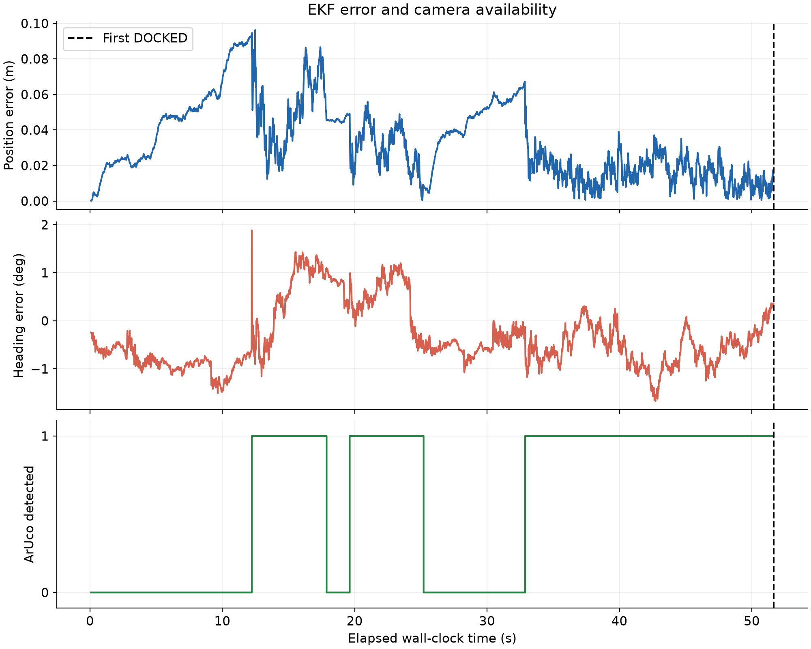

# Extended Kalman filter

[Project home](../README.md) · [Model](MODEL.md) · [Sensing](SENSING.md)

## State and inputs

The filter estimates planar base pose

$$\hat{\mathbf{x}}=[\hat p_x,\hat p_y,\hat\theta]^T.$$

The dynamic configuration predicts translation from measured left/right wheel
travel and heading from the simulated gyro increment. Wheel-difference yaw is
retained for the simplified baseline, but is not used for heading prediction in
the final TurtleBot3 configuration. This change addresses wheel-slip yaw drift
observed during in-place turns before the camera can see the station.

The spawn pose is known and initializes the estimate. The initial covariance is

$$P_0=\operatorname{diag}(0.03,0.03,(5\pi/180)^2).$$

The first two entries are position **variances** in m², not 3 cm standard deviations.
No unknown-start localisation or gyro-bias state is estimated.

## Prediction

With measured travel Δs_L, Δs_R and gyro increment Δθ_g:

$$\Delta s=(\Delta s_L+\Delta s_R)/2,\qquad
\theta_m=\hat\theta_k+\Delta\theta_g/2,$$

$$
\hat{\mathbf{x}}^-_{k+1}=\hat{\mathbf{x}}_k+
\begin{bmatrix}\Delta s\cos\theta_m\\\Delta s\sin\theta_m\\\Delta\theta_g\end{bmatrix}.
$$

Yaw is wrapped to [−π,π). The state Jacobian is

$$F=\begin{bmatrix}1&0&-\Delta s\sin\theta_m\\0&1&\Delta s\cos\theta_m\\0&0&1\end{bmatrix}.$$

For independent wheel-distance noise with variance σ_s² and independent gyro
increment noise with variance σ_g²:

$$G=\begin{bmatrix}\tfrac12\cos\theta_m&\tfrac12\cos\theta_m\\
\tfrac12\sin\theta_m&\tfrac12\sin\theta_m\\0&0\end{bmatrix},\qquad
J_g=\begin{bmatrix}-\tfrac12\Delta s\sin\theta_m\\\tfrac12\Delta s\cos\theta_m\\1\end{bmatrix},$$

$$P^-=FPF^T+G(\sigma_s^2I)G^T+J_g\sigma_g^2J_g^T+Q_{plant}.$$

At nominal settings, σ_s=0.0007 m, σ_g=(0.02 rad/s)(0.02 s), and

$$Q_{plant}=\operatorname{diag}(10^{-5},10^{-5},(0.05\pi/180)^2).$$

The process covariance is added once per 20 ms prediction. It represents
unmodelled motion rather than another sensor measurement. This is midpoint
kinematic propagation with first-order covariance linearisation, not a full
contact-state observer.

## Camera measurement model

Let the known horizontal landmark coordinates be (m_x,m_y)=(2.391,0) m and the
camera's forward offset be a=0.18 m. Define

$$d_x=m_x-p_x-a\cos\theta,\quad d_y=m_y-p_y-a\sin\theta,\quad
q=d_x^2+d_y^2,\quad r=\sqrt q.$$

The final filter uses

$$h(\mathbf{x})=\begin{bmatrix}r\\
\operatorname{wrap}(\operatorname{atan2}(d_y,d_x)-\theta)\\\theta\end{bmatrix}.$$

The third measurement is inferred from the panel's known orientation and the
camera PnP result. Its sign/mounting assumptions are specific to this scene.
The range/bearing Jacobian, with a heading row appended, is

$$H=\begin{bmatrix}
-d_x/r&-d_y/r&a(d_x\sin\theta-d_y\cos\theta)/r\\
d_y/q&-d_x/q&-1-a(d_y\sin\theta+d_x\cos\theta)/q\\
0&0&1
\end{bmatrix}.$$

Nominal camera covariance is

$$R=\operatorname{diag}(0.05^2,(2\pi/180)^2,(8\pi/180)^2).$$

This diagonal covariance matches the independent synthetic perturbations. The
underlying PnP errors can be correlated; R has not been fitted from a large
rendered calibration dataset. Likewise Q values are engineering tuning choices,
not experimentally identified hardware noise statistics.

Range is horizontal camera range, bearing is positive left, and yaw is world
heading. Ignoring the camera offset or using the wrong bearing sign would bias
the state estimate even if the matrix algebra were correct.

## Correction, gating and covariance

The filter computes

$$\nu=z-h(\hat{\mathbf{x}}^-),\quad S=HP^-H^T+R,\quad
K=P^-H^TS^{-1}.$$

Angular innovations are wrapped. The update is rejected when the squared
Mahalanobis innovation exceeds 11.34 for the three-component measurement.
The range/bearing-only baseline uses 9.21. These gates reject inconsistent
measurements; detection alone does not guarantee acceptance.

For an accepted measurement:

$$\hat{\mathbf{x}}^+=\hat{\mathbf{x}}^-+K\nu,$$

$$P^+=(I-KH)P^-(I-KH)^T+KRK^T.$$

The Joseph form reduces numerical covariance degradation. The implementation
wraps corrected yaw as well. If no marker is detected, prediction continues
without a camera correction; there is no substitution of ground-truth pose.

## Performance and validation

In the final eight-trial suite, per-trial position RMSE was **0.0354–0.0627 m**;
the unweighted mean of those eight per-trial RMSE values was **0.0449 m**. This
mean is not a pooled sample RMSE. Docking errors are reported separately.

Analytic camera Jacobians are checked with finite differences. Known-pose image
checks validate range, bearing and heading. A separate gyro-frame check integrated
a noiseless turn to approximately 0.6150 rad versus 0.6157 rad actual yaw change;
ground truth was used only to assess the check.

The historical fixed-suite logs record the estimate before motion and actual
pose after it, so those reported errors include a one-control-step offset. New
logs align actual pose, estimate and posterior P before current motion. They
record all six independent P entries and simulation time. The live display adds
a 2D joint 95% position ellipse (chi-square factor 5.99146) and marginal ±2σ values;
new state plots show each estimate and true state with its marginal ±2σ band.

For a calibrated Gaussian, ±2σ represents approximately 95.45% per component;
the 2D joint 95% ellipse uses a different scale. Neither is a guaranteed actual
error bound. Innovations/normalized-innovation histories are still not logged,
and statistical consistency is not established merely by drawing uncertainty.
Bias, dropouts and unknown initial state remain untested. The original eight-trial
results are retained unchanged; the added visualisation has a separate disturbed
regression under `output/uncertainty_validation/`.

Implementation: `main.py` functions `ekf_predict`,
`camera_prediction_and_jacobian`, `ekf_camera_update`; sensor input adapter:
`turtlebot.py` functions inside `configure`.
