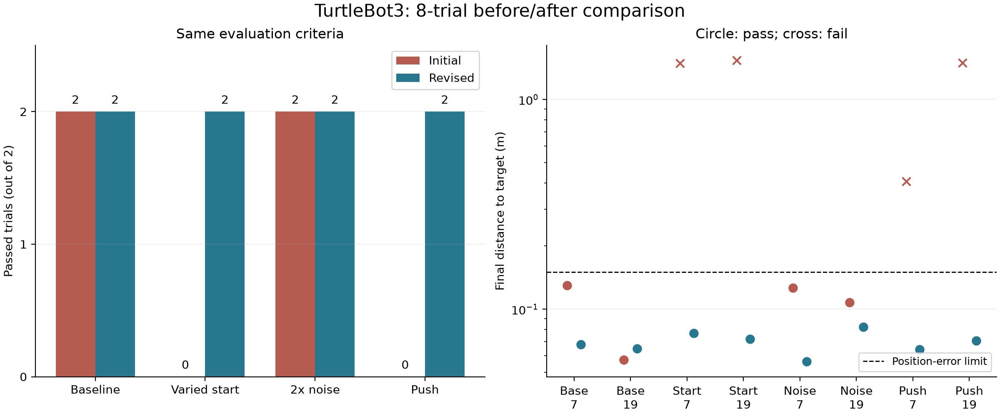
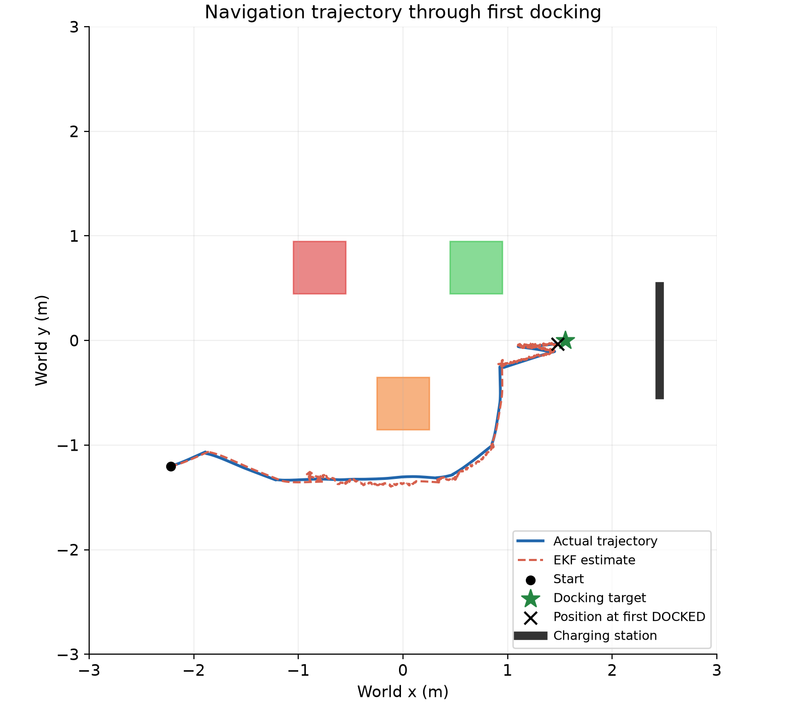
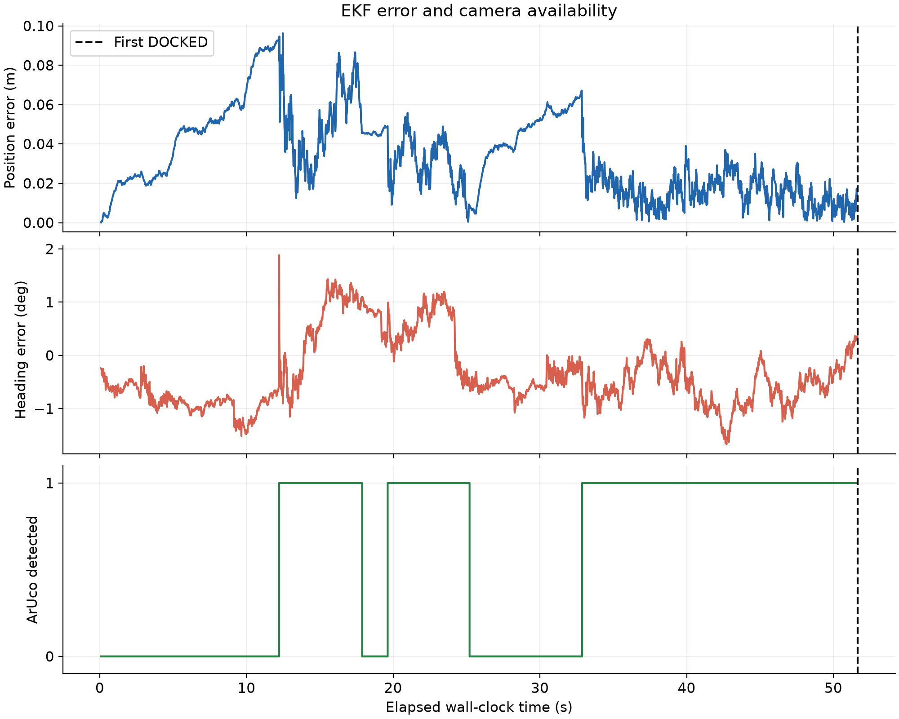

# Experiments and results

[Project home](../README.md) · [Reproduce the suite](REPRODUCIBILITY.md)

## Protocol

Two seeds, 7 and 19, are used for each of four conditions. Trials run in separate
processes against the dynamic TurtleBot3 plant. Each has a **140 simulated-second**
limit, excluding 0.5 s initial settling. The same external success definition is
used in both fixed suites:

1. Controller reaches camera-confirmed `DOCKED`.
2. Actual base-target position error ≤0.15 m.
3. Actual heading error ≤15°.
4. No detected robot contact with obstacles, walls or dock.

These are project evaluation thresholds, not a claim that the assignment brief
prescribes these exact numerical tolerances. Contact is checked at every 2 ms
physics step, excluding floor/wheel support contacts. Actual pose and contact
data are evaluation-only and are not controller inputs.

| Condition | Configuration |
|---|---|
| Baseline | Known spawn (−2.05, −1.35, 0), nominal sensor noise |
| Start pose | x uniform [−2.25,−1.85] m, y uniform [−1.65,−1.10] m, yaw uniform [−15°,15°]; spawn known to estimator |
| High noise | Encoder and camera measurement standard deviations doubled; revised pipeline also doubles gyro noise; EKF covariance matched |
| Push | 2 N world +y force on base for [12,12.3) simulated seconds |

Starting poses use a separate generator seeded with trial seed+1000. Full numeric
poses, package versions, limits and source hashes are stored in each suite's
configuration and per-trial JSON files. Both push trials record 15 forced control
steps, corresponding to 0.3 s at 50 Hz.

## Fixed-suite comparison

| Condition | Initial pipeline | Revised pipeline |
|---|---:|---:|
| Baseline | 2/2 | 2/2 |
| Varied starting pose | 0/2 | 2/2 |
| High noise | 2/2 | 2/2 |
| Push | 0/2 | 2/2 |
| **Total** | **4/8** | **8/8** |

The original varied-start cases both contacted the orange obstacle and timed out.
Original push seed 7 timed out without contact, 0.406 m from the target; push
seed 19 contacted the orange obstacle and timed out. All original failures are
retained in `output/robustness_initial/`.

The revised stack combines a 360° scan, footprint-aware path planning, committed
waypoints, gyro-assisted prediction, latched marker acquisition and docking
realignment. The observed improvement belongs to this **combined pipeline**.
It is not an ablation study proving that a particular gain or sensor alone caused it.

## Revised per-trial measurements

| Condition | Seed | Actual target error (m) | Actual heading error (°) | Position RMSE (m) | Completion (simulated s) | Hazard contact steps |
|---|---:|---:|---:|---:|---:|---:|
| Baseline | 7 | 0.0680 | 2.255 | 0.0503 | 85.24 | 0 |
| Baseline | 19 | 0.0650 | 2.653 | 0.0358 | 66.58 | 0 |
| Start pose | 7 | 0.0769 | 3.214 | 0.0392 | 64.34 | 0 |
| Start pose | 19 | 0.0720 | 3.170 | 0.0440 | 62.94 | 0 |
| High noise | 7 | 0.0562 | 1.557 | 0.0627 | 89.52 | 0 |
| High noise | 19 | 0.0822 | 2.936 | 0.0354 | 65.18 | 0 |
| Push | 7 | 0.0642 | 2.927 | 0.0545 | 84.26 | 0 |
| Push | 19 | 0.0707 | 3.026 | 0.0369 | 66.90 | 0 |

Mean actual docking error was **0.0694 m**; maximum was **0.0822 m**. Mean
completion time was **73.12 simulated seconds**. The unweighted mean of the eight
position RMSE values was **0.0449 m**; this is not the RMSE obtained by pooling
all samples. Numerical results above are rounded from the raw CSV.

There is a measurable speed trade-off. In the two baseline trials, mean completion
time increased from **49.10 s to 75.91 s** (about 55%), while mean actual target
error decreased from **0.0937 m to 0.0665 m**. One individual initial baseline
trial had slightly lower final error than its revised counterpart. The revised
stack improves the tested failure outcomes at the cost of longer nominal routes
and recovery manoeuvres; it is not uniformly faster or better in every metric.

## Trajectory and estimation example

The robot takes a wider route around the orange obstacle. The short back-and-forth
segment near the station is the realignment manoeuvre, not a reset of base pose.
The actual and estimated paths remain close after the gyro/camera changes.

For this trial, actual final target error was 0.0769 m and position-estimation
RMSE was 0.0392 m. The plot's time axis is **wall-clock time** from the per-step
log. The table above uses simulated time from the trial runner; those durations
must not be interchanged.

## Interpretation and limits

- The eight trials were used during development. They are regression evidence,
  not an independent held-out evaluation or population success-rate estimate.
- Only two seeds per condition are represented, in one static obstacle room.
- Baseline refers to the nominal condition within each dynamic suite. The
  separate `main.py` simplified robot is a different reference implementation.
- High-noise covariance is matched; unknown covariance mismatch is not tested.
- The gyro assumes zero bias. Camera noise is added to derived measurements;
  visual blur, lighting variation and dropout are not established.
- LiDAR is idealised and no LiDAR range-noise test is included.
- Starting poses are known to the estimator; unknown initial localisation is untested.
- The marker location, panel orientation and camera mount are known.
- Local planning assumes unseen space provisionally free. No guarantee is made
  for mazes, dynamic obstacles or sensor failure.
- No physical charging mechanism, hardware test or hardware comparison is claimed.
- The historical final eight-trial comparison was collected on macOS. A separate
  [Windows verification](WINDOWS_VERIFICATION.md) passed 8/8 after invalid-camera
  rejection was added; the initial Windows 6/8 run is retained. This is not an
  identical-source platform benchmark or an independent holdout study.
- Historical fixed-suite pose errors include one control-step alignment offset because the
  estimate is logged before current motion and truth after it.

The later uncertainty update does not change control inputs, filter tuning or the
eight-trial evidence. A separate push-seed-7 regression reproduced 84.26 simulated
seconds, 0.0642 m actual target error and zero hazard contacts while logging
posterior covariance. New logs align pose/estimate/covariance before motion;
their RMSE need not equal the older, one-step-offset metric. The covariance plot
in the README comes from that new regression, not retrofitted covariance for the
original eight runs.

## Evidence locations

| Evidence | Location |
|---|---|
| Original fixed suite and failures | `output/robustness_initial/` |
| Final fixed suite | `output/robustness_final/` |
| Per-trial CSV/JSON/transcript | `<case>_seed<seed>.csv`, `.json`, `.txt` in the suite |
| Exact tested configuration | `output/robustness_final/config.json` |
| Tested source snapshots | `output/robustness_final/source/` |
| Machine-readable comparison | `output/robustness_comparison/comparison.csv` |
| Comparison report and image | `output/robustness_comparison/comparison.md`, `comparison.png` |

Adaptive `_probe` directories, smoke/debug checks and the stopped
`robustness_revised/` suite are excluded from this comparison. Selected figures
are copied into `docs/assets/` so the GitHub README is self-contained, with raw
logs retained as the source of truth for the reported measurements.
