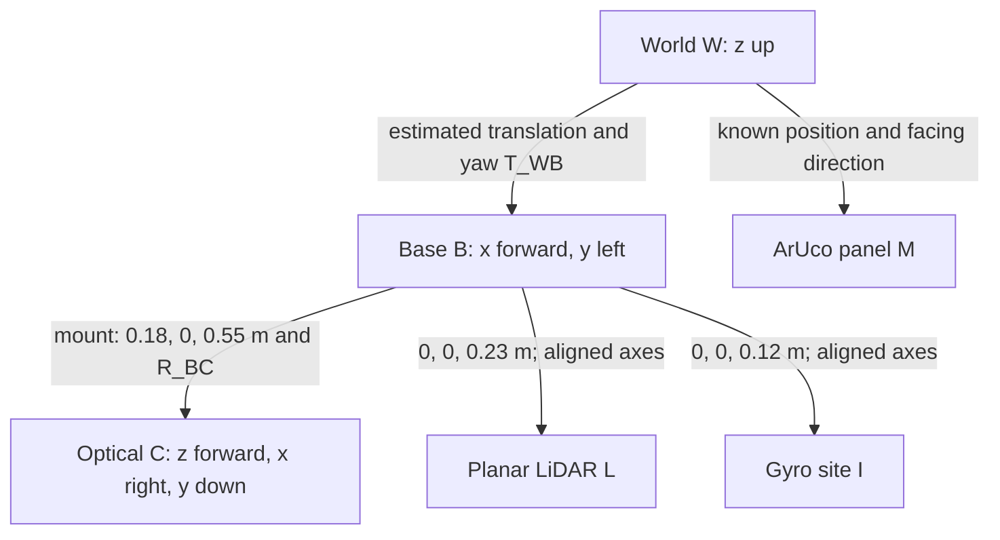

# Sensors, calibration and coordinate frames

[Project home](../README.md) · [Estimator](ESTIMATION.md)

## Coordinate conventions

| Frame | Axes / origin |
|---|---|
| World | +z up; yaw positive counterclockwise in the x–y plane |
| Base | +x forward, +y left, +z up |
| Camera optical | +z forward, +x right, +y down |
| Camera mount | Base-relative (0.18, 0, 0.55) m; zero mounting yaw |
| Planar scan | Base-relative (0, 0, 0.23) m; angles −180° to 175° in 5° steps |
| Gyro site | Base-relative (0, 0, 0.12) m; site +z rate used for yaw increment |
| Landmark | Panel centre horizontal coordinates (2.391, 0) m; known facing direction |

The camera-to-base horizontal offset is included in the EKF measurement model.



For column-vector camera coordinates, the nominal camera-to-base transform is

$$\mathbf p_B=R_{BC}\mathbf p_C+\mathbf t_{BC},\qquad
R_{BC}=\begin{bmatrix}0&0&1\\-1&0&0\\0&-1&0\end{bmatrix},\qquad
\mathbf t_{BC}=\begin{bmatrix}0.18\\0\\0.55\end{bmatrix}.$$

The nominal base-to-world transform uses estimated x/y translation and yaw.
The planar filter does not estimate base height, roll or pitch; this is a reduced
frame model rather than an estimate of all six degrees of freedom.

OpenCV lateral translation is positive right, so its sign is reversed when
forming a positive-left robot bearing. The panel texture convention is also
accounted for in the camera-derived heading. These signs are verified at known
poses; changing the panel orientation or mount requires updating the model.

## Camera intrinsics and marker geometry

The simulated image is 640×480 pixels with a vertical field of view of 60°.
Assuming square pixels and the configured ideal camera:

$$f_x=f_y=\frac{480/2}{\tan(60^\circ/2)}=415.69\ \mathrm{px},$$

$$K=\begin{bmatrix}415.69&0&320\\0&415.69&240\\0&0&1\end{bmatrix}.$$

Distortion coefficients are zero in the model. This is **simulator-derived
calibration**, checked against rendered known poses. It is not a real-camera
checkerboard calibration or a hardware calibration result.

`generate_marker.py` generates marker ID 0 from `DICT_4X4_50`. The 700-pixel
black marker is placed in a 980-pixel image with a white border; that image covers
a 0.68 m-wide plane. The PnP black-square side is therefore

$$s=0.68\frac{700}{980}=0.485714\ \mathrm m.$$

Using the complete white-bordered panel size as the black-square size would
systematically bias range. `solvePnP` with `SOLVEPNP_IPPE_SQUARE` returns the
marker translation and orientation. Horizontal camera range is
`hypot(t_x,t_z)`; positive-left bearing is `atan2(-t_x,t_z)`. It is not the full
3D translation norm. Heading uses the panel normal and its known world orientation.
The detector tries a mirrored image if the first detection fails, then restores
coordinates to the original image convention.

## Calibration checks

The validation script places the simulated plant at known poses **only for the
test**, renders the camera and compares measurements with the expected geometry:

| Base pose (x m, y m, yaw rad) | Expected range, approximately | Expected bearing, approximately |
|---|---:|---:|
| (1.0, 0, 0) | 1.211 m | 0 rad |
| (1.4, 0.1, −0.1) | 0.816 m | −0.000693 rad |
| (0.7, −0.2, 0.1) | 1.523 m | 0.01982 rad |

Checks allow <0.05 m range error, <0.02 rad bearing error and <0.15 rad heading
error. The analytic range/bearing Jacobian is separately compared with central
finite differences. These checks passed on the revised model. They cover three
poses, not a complete field-of-view, lighting or reprojection-error study.

```bash
# macOS; use the Windows environment Python for the equivalent command
./.venv/bin/python scripts/validate_simulation.py --turtlebot --camera-only
```

## Encoder and gyro inputs

The dynamic adapter reads wheel **joint-angle changes**, multiplies by the
0.033 m radius and adds measurement noise. It does not use requested wheel
speeds as measured travel. Translation is the mean left/right travel.

The gyro measures angular velocity in its site frame. Its z component is
averaged over the ten 2 ms physics substeps and integrated over 20 ms. White
measurement noise is added at the 50 Hz input rate. It supplies an angular
increment, not absolute heading or base ground-truth orientation. The current
model assumes zero gyro bias; it does not demonstrate bias calibration or bias estimation.

## LiDAR model

The final model uses 72 MuJoCo rangefinders around 360°. A negative no-return
value is represented as 99 m in the shared pipeline. The planner uses finite
positive returns below 4 m. It transforms returns using the EKF pose and rebuilds
a temporary grid. There is no persistent SLAM map or ground-truth obstacle map.

This is an idealised planar scanner, not a complete LDS timing/intensity/dropout
model. The saved noise experiments do **not** inject LiDAR range noise.
The yellow lines in the viewer are diagnostic graphics, not additional sensors.

## Measurement uncertainty

| Added noise | Nominal standard deviation | High-noise case |
|---|---:|---:|
| Left/right wheel travel | 0.0007 m each per step | ×2 |
| Gyro yaw rate | 0.02 rad/s | ×2 |
| Camera horizontal range | 0.05 m | ×2 |
| Camera bearing | 2° | ×2 |
| Camera-derived yaw | 8° | ×2 |

These are configured Gaussian measurement perturbations, not noise parameters
identified from physical equipment. The high-noise experiment also adjusts EKF
noise covariance to match. It therefore tests increased known measurement noise,
not unknown covariance mismatch. The camera perturbations are applied to derived
measurements; image blur, illumination changes and visual dropouts are not tested.

The EKF also includes model-process uncertainty to cover imperfect translation
and heading prediction. Its initial covariance, process covariance and measurement
covariance have different meanings; see [the EKF implementation](ESTIMATION.md).
