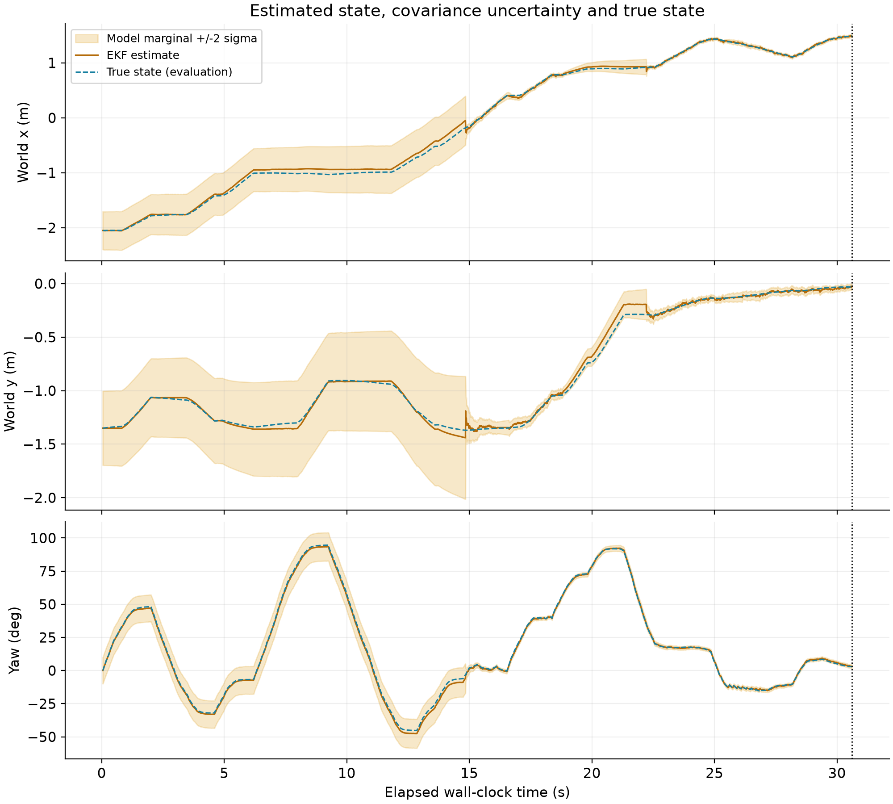

# Windows verification

[Project home](../README.md) | [Results](RESULTS.md)

Verified on Windows on 28 October 2026 using Python 3.14.7, MuJoCo 3.17.0, NumPy 2.5.4, SciPy 1.18.1 and OpenCV-contrib 5.0.0.93.

## Outcome

The corrected build passed **8/8 defined Windows trials**, using seeds 7 and 19 for baseline, varied known starting pose, doubled sensor noise and a lateral push. Each trial had a 140 simulated-second limit. Actual final target errors were **5.8-8.3 cm**, completion times were **60.2-84.7 simulated seconds**, and no hazard contacts were detected.

| Condition | Seed | Result | Actual target error (cm) | Completion (simulated s) |
|---|---:|---|---:|---:|
| baseline | 7 | PASS | 5.81 | 83.82 |
| baseline | 19 | PASS | 6.56 | 69.38 |
| start_pose | 7 | PASS | 6.11 | 65.54 |
| start_pose | 19 | PASS | 7.48 | 60.16 |
| high_noise | 7 | PASS | 6.55 | 83.70 |
| high_noise | 19 | PASS | 8.34 | 65.62 |
| push | 7 | PASS | 6.88 | 84.72 |
| push | 19 | PASS | 7.33 | 67.88 |

## Failure diagnosis and correction

The first Windows suite passed 6/8. The varied-start seed 19 and high-noise seed 19 trials stopped with non-finite state/covariance and an invalid actuator-control warning. Instrumenting the varied-start failure located the first non-finite estimated state immediately after a camera EKF update whose prior state and covariance were finite. The detector checked translation but did not check rotation or the derived panel normal; the EKF also lacked a finite-measurement check.

The detector now rejects non-finite rotation, translation and panel normals. The EKF rejects a non-finite measurement vector before updating its state or covariance. Regression checks inject invalid PnP rotation and range/bearing/heading measurements and verify rejection without posterior changes. No ground truth is used for this rejection, and no controller gains or success thresholds were changed.

The complete fixed suite was rerun after the correction. All successes and failures from the first run remain available; they are not included in the final 8/8 count. These are development-used cases, not independent holdout trials or a population reliability estimate. Sensor bias/dropout, unknown initial localisation and unseen environments remain untested.

## Evidence

- [Original Windows suite: 6/8](../output/robustness_windows/summary.csv), including failure transcripts and tested source snapshots.
- [Corrected Windows suite: 8/8](../output/robustness_windows_final/summary.csv).
- [Windows environment and source hashes](../output/robustness_windows_final/config.json).
- [Tested corrected sources](../output/robustness_windows_final/source/).
- [Windows push-trial metrics and plots](../output/robustness_windows_final/plots/push_seed7/summary.md).



Navigation geometry/braking/recovery checks, three known-pose camera checks, the measurement Jacobian check and invalid-measurement regressions passed on Windows. An interactive nominal run also reached DOCKED and saved its CSV; the Windows plotting command completed successfully. Headless suite results do not verify screen recording or video upload.

The historical macOS 4/8-to-8/8 comparison is retained unchanged. The Windows run uses the later covariance-logging build with invalid-camera rejection, so it is a separate verification of the current build rather than an identical-source platform benchmark. The suite-generated summary contains a generic Windows-check reminder; this report and the win32 configuration record the actual completed Windows execution.

## Reproduce

Run from a fresh Windows environment after following [setup](SETUP.md). Choose an output directory that does not already exist.

```powershell
.\.venv\Scripts\python.exe scripts\check_navigation.py
.\.venv\Scripts\python.exe scripts\validate_simulation.py --turtlebot --camera-only
.\.venv\Scripts\python.exe scripts\run_robustness.py --seeds 7 19 --max-seconds 140 --output output\robustness_windows_repeat
```
